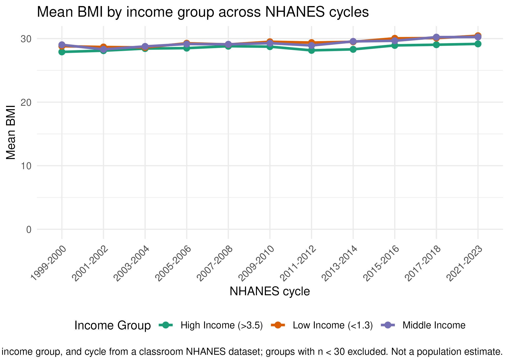

## Question And Audience

**Audience:** A public-health analyst preparing a short briefing on descriptive BMI patterns in the classroom NHANES equity dataset

**Question:** Among adults age 20-80, how does mean BMI vary across NHANES cycles for one selected income group?

**Why it matters:** To better understand who is more vulnerable to obesity in different income group.

## Evidence {.smaller}

{width=100%}

The figure shows different trend of BMI of each income group across NHANES cycles. The high income group has lower BMI across most NHANES cycle compared to middle or low income group. 

Source note: The data source is from the public use NHANES files at the CDC, made into a classroom use NHANES health equity csv file. [@cdc-nhanes].

## Limitation And Next Step

**Limitation:** This dataset is unweighted and descriptive which doesn't allow to inference causality of the result. 

**Next step:** Use the actual NHANES dataset so that the survey weights can be used for analysis allowing the result to capture the a nationally representative estimates. 

**AI-use note:** AI was not used to help with the wording of the slides. AI helped to make the PNG file look bigger when rendered. (AI prompt: Make the PNG file look bigger when rendered)
